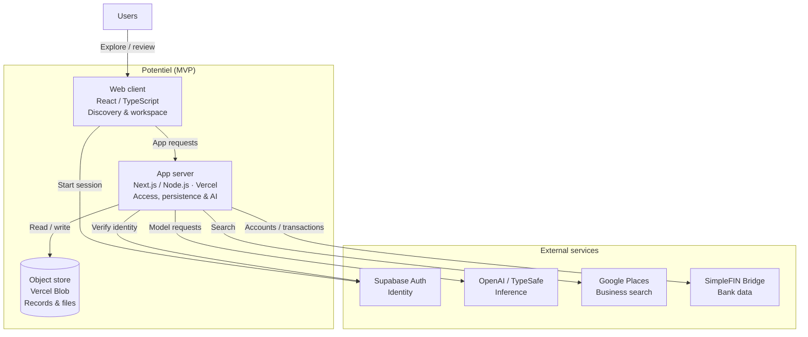

[← Back to my profile](../../README.md)

# Potentiel

**My role:** I define the product direction, make architecture and implementation trade-offs, guide coding agents, and review and accept the resulting changes.

## What is Potentiel?

Potentiel helps SME owners prepare their businesses for sale, connects them with local buyers who want to become owner-operators, and gives brokers tools to support the transaction.

The problem is two-sided: owners preparing to step back may struggle to assess their business’s value, prepare a handover and communicate its strengths. Buyers may struggle to find suitable opportunities and assess the financial and operational risks of taking over. The focus is on local owner-operators who want to sustain an established business.

It serves three groups:
- Owners preparing to step back or retire, who need to assess their business and re-organize their staff and financial documents.
- Buyers who want to acquire and operate an established business with clear opportunities to improve operations rather than start from scratch.
- Brokers who need to qualify prospects, manage their pipeline and match buyers with suitable businesses.

## Product & AI feature set

Potentiel is deployed and used for prospect demonstrations and account management. [Contact me on LinkedIn](https://www.linkedin.com/in/frederichanna/) to request a demo or discuss access to the private implementation evidence.

The analysis and matching workflow currently uses recruitment documents as a POC. Explicit job requirements provide a bounded starting point that a human reviewer can check against the source documents. Adapting this workflow to business acquisitions remains the intended future direction.

### Demo walkthroughs

#### 1. Owner: Business assessment and data room preparation

The owner has already claimed the opportunity and now prepares it for publication by adding an assessment and supporting documents.

https://github.com/user-attachments/assets/36da42b2-5abc-49b5-bf3e-7d142fb0492b

*Preparing an assessment or uploading documents does not publish the opportunity.*

#### 2. Buyer: Opportunity discovery and profile matching (recruitment POC)

A buyer reviews an opportunity and its documents, then signs in to compare explicit job requirements against their profile.

Matching reuses a stored analysis revision alongside selected profile evidence. Separating extraction from matching supports reuse, at the cost of an extra processing stage and orchestration.

https://github.com/user-attachments/assets/2cc732d1-936c-4efe-be5f-303472362fac

*Inspect requirement-level matches, supporting evidence and gaps.*

#### 3. Admin: Run inspection and human evaluation

An administrator reviews LLM run quality, latency and estimated cost, then inspects a run and records a human assessment.

Each run retains its inputs, outputs and token usage; human evaluations are stored separately to assess quality without overwriting the result. Reviewers can flag potential hallucinations and bias. The pass rate is `passed / (passed + failed)`, shown with sample size and review coverage; unevaluated runs are excluded.

https://github.com/user-attachments/assets/43734aa8-c0ff-4fe4-95c0-a9e0542e8f9f

Under the hood: a matching run and its human evaluation

*Illustrative, partial inspection response using the implemented schemas. All identifiers, model/version labels, timings, token counts, content and evaluation are synthetic; omitted fields are not shown.*

Model, prompt, schema and application versions identify the execution context. Timestamps and token usage support latency and cost analysis. The structured output pins its analysis revision and evidence snapshot, with citations distinguishing extraction from inference. The evaluation is projected from a separate log: `completed` describes execution, while `passed` records a human assessment.

[Run metadata and structured output](https://github.com/fredow/potentiel-app/blob/040bf8a9bf4d97622a440d0e842c7b93cfea76f9/apps/web/features/agent-runs/domain.ts#L488) · [Separate evaluation log](https://github.com/fredow/potentiel-app/blob/040bf8a9bf4d97622a440d0e842c7b93cfea76f9/apps/web/features/agent-runs/domain.ts#L80) *(private; access available on request).*

~~~json
{
  "id": "00000000-0000-4000-8000-000000000001",
  "kind": "profile_match",
  "status": "completed",
  "provider": "openai",
  "model": "demo-model-id",
  "promptVersion": "profile-match-demo-v1",
  "schemaVersion": "demo-v1",
  "applicationRevision": "demo-app-revision",
  "createdAt": "2026-11-09T12:00:00Z",
  "completedAt": "2026-11-09T12:00:08Z",
  "tokenUsage": {
    "inputTokens": 4200,
    "outputTokens": 650,
    "totalTokens": 4850
  },
  "structuredOutput": {
    "analysisRevisionId": "analysis-demo-01",
    "evidenceSnapshotId": "evidence-demo-01",
    "requirementFindings": [
      {
        "requirementId": "req-01",
        "requirementLabel": "Own deployment and production operations",
        "fit": "medium",
        "support": "inferred",
        "rationale": "Deployment experience is documented; ongoing operational ownership is not established.",
        "citations": [
          {
            "sourceType": "analysis_revision",
            "analysisRevisionId": "analysis-demo-01",
            "requirementId": "req-01",
            "excerpt": "Own deployment and production operations."
          },
          {
            "sourceType": "person_evidence",
            "evidenceSnapshotId": "evidence-demo-01",
            "fileId": "cv-demo",
            "excerpt": "Deployed a Next.js application on Vercel."
          }
        ]
      }
    ]
  },
  "evaluation": {
    "state": "passed",
    "eventCount": 1,
    "latestEvent": {
      "method": "manual",
      "rationale": "Citations support the finding; the uncertainty is explicit."
    }
  }
}
~~~

Validation checks structure and reference consistency; human review assesses whether the evidence supports the conclusion.

### Main product decisions

| ID | Principle | Description |
|---|---|---|
| 1 | Map-first discovery | The map prioritises geographic context and local identity; a compact design system preserves map space. The secondary table supports sorting and pipeline management. |
| 2 | Early value, qualified participation | Guided owner flows and self-service buyer/broker flows offer value before registration. The intended access model adds a qualification call before full access and introductions, prioritising participant quality at the cost of manual work and slower onboarding.  The network-effect hypothesis is that relevant businesses attract qualified buyers, whose participation increases value for owners and brokers. |
| 3 | One opportunity workspace across roles | Assessments, documents and the collaborative canvas share one opportunity, giving participants a common basis for discussion and next steps.  Public and internal data-room areas control what is shared; common context does not imply unrestricted access. |

## Engineering

### System architecture

#### Container diagram (C4 level 2)

Potentiel’s containers sit inside the system boundary; external services sit outside. Service calls use HTTPS, with session cookies on browser-to-server requests.

The architecture prioritises a small operational footprint and rapid MVP iteration to validate product needs. One deliberate trade-off is deferring the migration from blob persistence to Postgres, which could introduce ongoing schema, testing and deployment overhead. That investment would be justified when product workflows require relational queries, integrity constraints or transactional updates.

#### Tech stack

| Family | Technology |
|---|---|
| Application & Back-end | TypeScript, Next.js, React, Node.js; Vercel; Supabase Auth (JWT); Vercel Blob. |
| Design system & Interfaces | shadcn-style components, Tailwind, Lucide; Storybook (BrandKit); MapLibre, Recharts, Excalidraw. |
| AI and Integrations | OpenAI (analysis/matching), TypeSafe/JEV (operational assessment), Zod; Google Places, SimpleFIN, PostHog (analytics), Nodemailer (email). |
| Delivery tooling | OpenSpec, Mermaid, Playwright, GitHub Actions; Vercel branch/PR previews. |

### Spec-driven AI-assisted delivery

I use OpenSpec to keep requirements, design and acceptance criteria traceable while coding agents work in parallel. Human approval gates guide delivery, and retrospectives improve the next iteration.

I create an initial HTML prototype during Explore to get visual feedback on the product direction, then refine it alongside the specifications during Propose before implementation.

**Example — profile matching (private evidence; access available on request):** [Specification](https://github.com/fredow/potentiel-app/blob/f8827bafd4eb9567a32fe5d71e082a947fe017e7/openspec/changes/evaluate-professional-profile-fit/specs/professional-profile-matching/spec.md) · [Implementation PR #222](https://github.com/fredow/potentiel-app/pull/222) · [CI validation](https://github.com/fredow/potentiel-app/actions/runs/38299600797).

```mermaid
flowchart TB
    START["Human: Intent & constraints"]

    subgraph EXPLORE["1. Explore"]
        E["Explore behaviour"]
        EX["HTML prototype<br/>Sequence diagram"]
        ALIGN{"Human: Direction clear?"}
        E -.-> EX
        EX --> ALIGN
    end

    subgraph PROPOSE["2. Propose"]
        P["Specs, design & tasks"]
        PX["ERD / components<br/>Proposal video"]
        APPROVE{"Human: Approve plan & budget?"}
        P -.-> PX
        PX --> APPROVE
    end

    subgraph APPLY["3. Apply"]
        BUILD["Build & verify PR stack"]
        ACCEPT{"Human: Accept preview stack?"}
        DEPLOY["Merge & deploy<br/>Smoke checks"]
        VIDEO["Release video"]
        BUILD --> ACCEPT
        ACCEPT -->|"Accepted"| DEPLOY
        DEPLOY -->|"Checks pass"| VIDEO
    end

    subgraph ARCHIVE["4. Archive"]
        SYNC["Sync specs"]
        RETRO["Delivery retrospective"]
        CLOSE["Archive change"]
        SYNC --> RETRO --> CLOSE
    end

    NEXT["Human: Refine guidance"]

    START --> E
    ALIGN --> P
    APPROVE -->|"Approved"| BUILD
    VIDEO --> SYNC
    CLOSE --> NEXT

    classDef agent fill:#000,stroke:#fff,color:#fff
    classDef addition fill:#000,stroke:#fff,stroke-width:2px,stroke-dasharray:4 3,color:#fff
    classDef human fill:#fff4db,stroke:#8a6500,stroke-width:3px,color:#17212d

    class E,P,BUILD,DEPLOY,SYNC,CLOSE agent
    class EX,PX,VIDEO,RETRO addition
    class START,ALIGN,APPROVE,ACCEPT,NEXT human
```

*My adapted OpenSpec workflow: Black boxes indicate agent execution, yellow indicate human input/decisions and dashed-lines highlight my additions to the standard.*

Under the hood: OpenSpec agent guidance

*Adapted configuration example based on `openspec/config.yaml`, including intended refinements; other instructions are omitted. This is not a verbatim excerpt or evidence that every historical change followed it.*

~~~yaml
schema: spec-driven
rules:
  proposal:
    - |
      Code quality target:
      - Include the target quality level for this change: Straw, Wood, or Concrete. Explain the expected robustness and trade-offs in one sentence.
      - Include a qualitative estimate of maintainability risk (code entropy): Low, Medium, or High. Identify the main source of complexity supporting the estimate.
  design:
    - |
      Visual prototype:
      - For every change that adds or materially modifies user-visible front-end behavior,
        create an initial HTML prototype during Explore, then refine it alongside the delta
        specs during Propose before implementation. Follow `docs/openspec-prototype-previews.md`.
  tasks:
    - |
      Visual changes:
      - For every visual product-flow change within an OpenSpec change, include a proposal video
        showing the prototype and intended product flow before implementation.
      - After implementation, include a video recap following `docs/video-recap-guidelines.md`
        that records the final accepted implementation before archive.
      - Ground client-facing changes in the BrandKit: `brand-kit/README.md`.
operations:
  apply:
    guidance:
      - |
        Agent and orchestration:
        - Give every worker a separate worktree and `codex/` branch from the exact dependency
          commit.
        - Use native GitHub Stacks for dependent PRs; keep independent PRs separate.
      - |
        Completion retrospective:
        - At verified end-to-end completion, summarize outcomes, recurring defects, rework,
          blockers and avoidable waits, citing concrete examples.
        - Recommend up to three improvements with their exact target: spec, design, tests,
          tooling or workflow. Propose changes without applying them unless authorized.
~~~

[Configuration baseline](https://github.com/fredow/potentiel-app/blob/040bf8a9bf4d97622a440d0e842c7b93cfea76f9/openspec/config.yaml) · [Prototype preview contract](https://github.com/fredow/potentiel-app/blob/040bf8a9bf4d97622a440d0e842c7b93cfea76f9/docs/openspec-prototype-previews.md) · [Video recap contract](https://github.com/fredow/potentiel-app/blob/040bf8a9bf4d97622a440d0e842c7b93cfea76f9/docs/video-recap-guidelines.md) *(private; access available on request).*

### Future directions

Selected next steps on my product and engineering roadmap:

- **Automated valuation:** Explore a POC that estimates business value from financial statements, with explicit assumptions and human review.
- **Owner–buyer matching:** Adapt the recruitment matching LLM POC to the acquisition domain and expand the information captured in buyer portfolios.
- **LLM evaluations:** Build human-reviewed benchmarks for each workflow and compare prompts, context and model choices using quality, latency and token consumption. Explore LLM-as-a-judge alongside human assessments.

I also plan to explore and share these topics in more depth:

- **Harness engineering:** the context, tools, verification and feedback loops supporting my AI-assisted development process.
- **One change from specification to delivery:** OpenSpec artifacts, the PR stack, validation evidence and retrospective.
- **Grounded sales-deck generation:** investigating hallucinations when generating presentations from a narrative and lead context, in a separate application.
